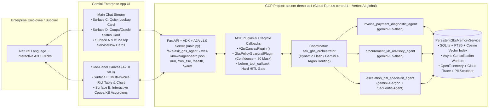

# Ask GBS — Enterprise Finance & Procurement Helpdesk ADK Agent (`ask-gbs-agent`)

Multi-agent conversational AI system built on **Google Agent Development Kit (`google-adk`)**, engineered for **Gemini Enterprise** (Chat Stream + Side-Panel **A2UI v0.9 `Canvas`**) on Google Cloud Project **`aecom-demo-uc1`** and aligned 1:1 with all **19 AgentOps Criteria (95 / 95 Points)** of the *AI in 5 Days* FDE Assessment.

---

## 1. Problem & Solution Statement

### The Problem
Enterprise Global Business Services (**GBS**) Accounts Payable and Procurement teams receive thousands of repetitive tier-1 ServiceNow tickets asking *"When will my invoice be paid?"*, *"Why is my invoice on hold?"*, *"How do I code a Non-PO invoice?"*, or *"Can we accelerate an urgent payment?"*. Static intake forms force users through rigid dropdowns, cannot ask clarifying questions when an invoice or PO identifier is omitted, and route incomplete submissions into manual analyst queues.

### The Ask GBS Solution
**Ask GBS** replaces static forms with a read-only, policy-governed **Coordinator + Specialist Sub-Agent** system on `google-adk`:
1. **Multi-Turn Slot Filling (`Surface C`)**: Detects missing identifiers and renders an inline **A2UI v0.9 `MaterialCard` Quick-Lookup Form**.
2. **Cross-System Coupa + Oracle Diagnostics (`Surface D`)**: Reconciles Coupa approval chains, 3-way match goods receipts, `VertexCallOut` tax logs, Oracle Financials EFT vouchers, **Net 30 Coupa Submission Date math (`KB0015901`)**, and the **Supplier Email Exemptions Registry (`KB0015802`)**.
3. **Gemini Enterprise Side-Panel `Canvas` (`Surface E`)**: Renders multi-invoice legal-hold statement reconciliations (`RichTable` + Vega-Lite `Chart`) and collapsible Coupa KB guides (`MaterialExpansionPanel`, titles `<= 62` chars) without cluttering the chat stream.
4. **2-Step Human-in-the-Loop ServiceNow Case Creation (`Surface A` -> `Surface B`)**: Enforces a hard `before_tool_callback` code stop (`enforce_hitl_confirmation_gate`) so `submit_confirmed_servicenow_case` cannot execute until the human user confirms the pre-populated **ServiceNow Case Intake Form (`Surface A`)**, generating an illustrative **Confirmation Receipt Card (`CS9940120`, `Surface B`)** with zero live ERP mutation.

---

## 2. System Architecture



---

## 3. 19-Criterion AgentOps Rubric Traceability Matrix (95 / 95 Points)

| Category | Criterion (5 Pts) | Exact Implementation Class / Function | Repository File(s) |
| :--- | :--- | :--- | :--- |
| **1. Tool & Interface Design (20 pts)** | **1.1 Comprehensive Tool Docstrings** | Google-style docstrings (`Summary`, `Business Rules`, `Args`, `Returns`, `Example`) on all 7 ADK tools | `ask_gbs_agent/tools/invoice_tools.py`, `ask_gbs_agent/tools/kb_tools.py`, `ask_gbs_agent/tools/servicenow_tools.py` |
| | **1.2 Descriptive Naming** | Verb-noun names: `lookup_coupa_oracle_invoice_record`, `request_missing_invoice_identifier_form`, `open_interactive_coupa_kb_canvas`, `evaluate_supplier_exemption_status`, `open_urgent_payment_acceleration_form`, `stage_servicenow_case_intake_form`, `submit_confirmed_servicenow_case` | `ask_gbs_agent/tools/*.py` |
| | **1.3 Explicit JSON Schemas** | Strict Pydantic v2 `BaseModel` (`ConfigDict(extra="forbid")`, `Field(...)`) for all tool inputs & outputs | `ask_gbs_agent/schemas.py` |
| | **1.4 Guided Error Handling** | `GuidedToolErrorResponse` (`status="RECOVERABLE_ERROR"`, `error_code`, `llm_recovery_instruction`, `suggested_next_tool`) | `ask_gbs_agent/schemas.py`, `ask_gbs_agent/tools/*.py` |
| **2. Context & Memory (20 pts)** | **2.1 Robust System Instructions** | Constitutional `AGENT_CONSTITUTION_PROMPT` (`<PERSONA>`, `<OPERATIONAL_RULES>`, `<DECISION_TREE>`, `<SECURITY_GUARDRAILS>`, `<OUTPUT_CONSTRAINTS>`) | `ask_gbs_agent/prompts.py` |
| | **2.2 History Compaction** | `HistoryCompactionManager` (token sliding window + `<a2a_datapart_json>` stripping + Vertex AI `CachedContent`) | `ask_gbs_agent/memory/compaction.py`, `ask_gbs_agent/callbacks.py` |
| | **2.3 Persistent Session State** | `PersistentGbsMemoryService` (SQLite + FTS5 + Cosine Vector DB seeded from `gbs_source_of_truth_data.md` + `VertexAiSessionService` / `VertexAiMemoryBankService`) | `ask_gbs_agent/memory/persistent_store.py` |
| | **2.4 Async Memory Operations** | Non-blocking `asyncio.create_task()` background consolidation (`schedule_async_memory_consolidation`, `consolidate_session_memory_async`) | `ask_gbs_agent/memory/async_worker.py`, `ask_gbs_agent/callbacks.py` |
| **3. Orchestration & Logic (20 pts)** | **3.1 Multi-Agent Patterns** | `ask_gbs_orchestrator` Coordinator + 3 Specialist Sub-Agents + `reconciliation_to_escalation_pipeline` (`SequentialAgent`) | `ask_gbs_agent/agent.py`, `ask_gbs_agent/sub_agents/*.py` |
| | **3.2 Strategic Model Routing** | `StrategicModelRouter` (`gemini-2.5-flash` for routine lookups/KBs; `gemini-4-argon` for orchestration, `PAY-03` legal holds, `PAY-05` security mismatches, `INV-11` holds) | `ask_gbs_agent/orchestration/model_router.py` |
| | **3.3 Guardrails & Policy Plugins** | `GbsPolicyGuardrailPlugin(BasePlugin)` + `SelfEvaluationGuardrail` (`PAY-05` sets `confidence_score = 62 < 80`, masks bank digits, blocks direct ERP writes) | `ask_gbs_agent/plugins/policy_plugin.py`, `ask_gbs_agent/plugins/a2ui_canvas_plugin.py` |
| | **3.4 Human-in-the-Loop Hooks** | `enforce_hitl_confirmation_gate` in `before_tool_callback` blocking `submit_confirmed_servicenow_case` until `state["hitl_user_confirmed"] == True` | `ask_gbs_agent/callbacks.py`, `ask_gbs_agent/tools/servicenow_tools.py` |
| **4. Observability & Tracing (20 pts)** | **4.1 Structured JSON Logging** | `StructuredJsonLogger` (`python-json-logger` + `google-cloud-logging`) with zero `print()` statements in agent package | `ask_gbs_agent/observability/structured_logger.py` |
| | **4.2 Intent vs. Outcome Capture** | `IntentOutcomeTracker.log_intent` (`phase="INTENT"`) and `log_outcome` (`phase="OUTCOME"`) correlated by `execution_id` | `ask_gbs_agent/observability/intent_outcome_tracker.py` |
| | **4.3 Distributed Tracing** | OpenTelemetry `TracerProvider` + `CloudTraceSpanExporter(project_id="aecom-demo-uc1")` + nested spans (`gbs.turn`, `gbs.model_routing`, `gbs.rag_retrieval`, `gbs.tool_execution`, `gbs.a2ui_canvas_build`) | `ask_gbs_agent/observability/tracing.py` |
| | **4.4 PII Redaction** | `PiiRedactionScrubber` + `PiiLoggingFilter` (regex scrubbing for emails, SSNs, IBANs, bank accounts, phones + optional Google Cloud DLP `DlpServiceClient`) | `ask_gbs_agent/observability/pii_redactor.py` |
| **5. Infrastructure & CI/CD (15 pts)** | **5.1 Automated Evaluation Suites** | 31-scenario Golden Dataset suite + A2UI v0.9 10-rule compliance tests + 19-point rubric tests + GitHub Actions CI | `eval/golden_dataset.json`, `eval/run_adk_evaluation.py`, `tests/*.py`, `.github/workflows/agentops_ci.yml` |
| | **5.2 Infrastructure as Code** | Complete Terraform module provisioning Cloud Run v2 (`min_instance_count = 1`), Artifact Registry, GCS, Secret Manager & least-privilege IAM in `aecom-demo-uc1` | `terraform/main.tf`, `terraform/variables.tf`, `terraform/outputs.tf` |
| | **5.3 Secure Secret Management** | `SecretManagerResolver` (`google-cloud-secret-manager`) resolving `projects/aecom-demo-uc1/secrets/.../versions/latest` with `.env` fallback | `ask_gbs_agent/config/secret_manager.py`, `.gitignore` |

---

## 4. Quickstart & `adk` CLI Usage

### 4.1 Local Installation & Verification
```bash
python3 -m venv .venv
source .venv/bin/activate
pip install -r requirements.txt

cp .env.example .env

# Run full pytest suite & Golden Dataset evaluation harness
pytest -v
python eval/run_adk_evaluation.py
```

### 4.2 Running Locally with Google ADK CLI
```bash
# Launch interactive ADK Developer Web UI (http://localhost:8000)
adk web

# Launch headless ADK OpenAPI / SSE server
adk api_server

# Run live ADK trajectory evaluations against Vertex AI (ADK-native EvalSet)
adk eval ask_gbs_agent eval/ask_gbs_golden.evalset.json
```

---

## 5. Cloud Deployment (`aecom-demo-uc1`) & Gemini Enterprise Registration

### 5.1 Provision Infrastructure via Terraform
```bash
cd terraform
terraform init
terraform plan -var="project_id=aecom-demo-uc1" -var="region=us-central1"
terraform apply -var="project_id=aecom-demo-uc1" -var="region=us-central1"
```

### 5.2 Deploy to Cloud Run (A2A + `/warm`) or Vertex AI Agent Engine
```bash
# Option A: Cloud Run deployment (builds Dockerfile/main.py with A2A v1.0, min-instances=1 & GOOGLE_CLOUD_LOCATION=global for Gemini 4 Argon)
./deploy_cloud_run.sh

# Option B: Vertex AI Agent Engine deployment
adk deploy agent_engine --project=aecom-demo-uc1 --region=us-central1 ask_gbs_agent
# Or via Python SDK script:
python deploy_agent_engine.py --project_id=aecom-demo-uc1 --location=us-central1
```

### 5.3 Register in Gemini Enterprise (A2A v1.0 Agent Card)
```bash
export AGENT_ENDPOINT_URI="$(gcloud run services describe ask-gbs-agent --project=aecom-demo-uc1 --region=us-central1 --format='value(status.url)')"
./register_gemini_enterprise.sh
```
Or in **Google Cloud Console > Gemini Enterprise (Agent Builder)** (`project=aecom-demo-uc1`):
1. Open your **Gemini Enterprise App** -> **Agents** -> **Create / Register Agent** -> **Custom Agent (ADK / A2A)**.
2. Set Display Name to `Ask GBS — Enterprise Finance & Procurement Helpdesk`, paste `${AGENT_ENDPOINT_URI}/a2a/ask_gbs_agent` (Agent Card auto-discovered at `/.well-known/agent-card.json`), bind `ask-gbs-agent-sa@aecom-demo-uc1.iam.gserviceaccount.com`, and click **Save & Publish**.

---

## 6. 4-Minute Golden Path Demo Script

1. **Pre-Warm Runtime**:
   ```bash
   curl -X POST "${AGENT_ENDPOINT_URI}/warm"
   ```
2. **Turn 1 — Missing Identifier Clarification (`Surface C`)**:
   > *"I need help with an invoice that hasn't been paid yet."*
   - Renders the inline **A2UI Quick-Lookup Card (`gbs-missing-identifier-card`)**.
3. **Turn 2 — Cross-System Coupa/Oracle Diagnostic & Net 30 Math (`PAY-01` -> `Surface D`)**:
   > *"Check invoice INV00026056 for FieldSync Ops Ltd."*
   - Renders the **Coupa & Oracle Status Tracker Card**, explaining why PDF date `2025-11-30` vs. Coupa Submission Date `2025-12-15` yields Net 30 Due Date `2026-01-14` (`KB0015901`, EFT `1664447`).
4. **Turn 3 — Side-Panel `Canvas` Multi-Invoice Legal Hold Reconciliation (`PAY-03` -> `Surface E`)**:
   > *"We received a Second Payment Reminder Notice from BioData Registry Online for invoices 23469, 23104, and 23288 threatening an account freeze."*
   - Routes to `gemini-4-argon` (Gemini 4 Argon) and opens the **Gemini Enterprise Side-Panel `Canvas`** with the 3-invoice `RichTable` (`23469` Paid EFT `1667857`, `23104` Pending Approval, `23288` Pending Receipt) and AP breakdown chart.
5. **Turn 4 — Illustrative 2-Step HITL ServiceNow Case Creation (`INV-11` -> `Surface A` & `Surface B`)**:
   > *"Titan Earthworks billed the wrong amount ($22,772) on approved invoice 2158."*
   - Stages the **A2UI ServiceNow Case Intake Form (`Surface A`)** -> click **Submit ServiceNow Case** -> passes the `before_tool_callback` HITL gate and renders the **Case Confirmation Receipt Card (`CS9940120`, `Surface B`)**.
