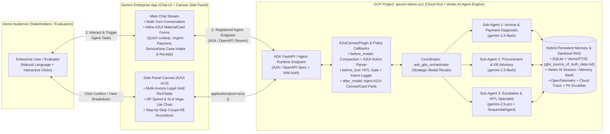

# Product Requirements Document (PRD): "Ask GBS" — Enterprise Finance & Procurement Helpdesk ADK Agent (Gemini Enterprise A2UI v0.9 & AI in 5 Days 95-Point Assessment Edition)

**Project Title**: Ask GBS — Enterprise Finance & Procurement Helpdesk Conversational Agent (`ask-gbs-agent`)  
**Assessment Track**: AI in 5 Days (FDE Training) Final Assessment — **Enterprise Agents Track** (Target Score: **95 / 95 Points**)  
**Development Environment**: Local Laptop with **VS Code + Antigravity (AGY)** -> Published to a **Public Root GitHub Repository**  
**Google Cloud Project ID**: `aecom-demo-uc1` (Region: `us-central1` | Gemini Enterprise Location: `global` / `us-central1`)  
**Target Runtime & UI Platform**: **Google Agent Development Kit (`google-adk`)** with **FastAPI / Cloud Run & Vertex AI Agent Engine** -> Registered in **Gemini Enterprise App UI** (Chat Stream + Side-Panel **A2UI v0.9 `Canvas`**)  
**Canonical Solution Workspace (Google Drive)**: [Phase 1 - Demo](https://drive.google.com/drive/folders/1qUKPiWFXeOkiGc8tSqLT2J-Y26czYXd0) (Folder ID: `1qUKPiWFXeOkiGc8tSqLT2J-Y26czYXd0`)  
**Companion Deliverables (in `Phase 1 - Demo` Drive Folder)**:
- Sanitized Source of Truth: `gbs_source_of_truth_data.md` ([Drive File](https://drive.google.com/file/d/1GNKL-OGHs73TLHF3d_UvtadeqZN_CLrN/view))
- VS Code Antigravity Prompt Sequence & GitHub/GCP Playbook: `adk_gemini_enterprise_scaffolding_prompt.md` ([Drive File](https://drive.google.com/file/d/1AfHhBJG_1ztbUO3sZSivpGrlAfgUxNQX/view))

---

## 1. Executive Summary & Dual Objective

### 1.1 Business Problem & Solution
Enterprise Finance and Procurement shared services (**Global Business Services — GBS**) are overwhelmed by repetitive tier-1 ServiceNow tickets where employees and suppliers ask: *"When will my invoice be paid?"*, *"Why is my invoice on hold?"*, *"How do I code a Non-PO invoice?"*, or *"Can we accelerate an urgent payment?"*. Static ServiceNow intake forms force users through rigid dropdowns, cannot ask clarifying questions when an invoice number is omitted, and drop every incomplete submission into a manual human queue.

**Ask GBS** replaces static helpdesk forms with a **multi-agent conversational AI system built on Google Agent Development Kit (`google-adk`)** and surfaced natively inside the **Gemini Enterprise App UI**:
1. **Conversational + Multi-Turn Slot Filling**: Understands natural language queries, detects missing or ambiguous identifiers (e.g., *"I need help with an invoice"*), and renders an inline **A2UI v0.9 Quick-Lookup Form (`MaterialCard`)** to capture missing slots.
2. **Sanitized Cross-System RAG & Deterministic Diagnostics**: Reconciles **Coupa** (approvals, PO vs. Non-PO routing, 3-way match receipts, `VertexCallOut` tax logs), **Oracle Financials** (EFT payment references, Net 30 submission math), the **Supplier Email Exemptions Registry**, and **ServiceNow KBs (`KB0015760`–`KB0016050`)** using 100% sanitized, realistic dummy data (`gbs_source_of_truth_data.md`).
3. **Side-Panel `Canvas` & Interactive A2UI v0.9 Controls**: Renders complex multi-invoice reconciliation tables (`RichTable`), spend/payment anomaly charts (Vega-Lite / `Canvas`), and step-by-step Coupa KB accordions (`MaterialExpansionPanel`) in the Gemini Enterprise **Side-Panel Canvas** without cluttering the chat stream.
4. **Illustrative 2-Step ServiceNow Ticket Creation (HITL)**: Whenever a user's question is beyond a simple RAG lookup in the source data or requires human back-office intervention (e.g., placing an Oracle payment hold on an approved invoice with a wrong amount, requesting a PDF remittance advice, or handling an out-of-scope custom inquiry), the agent invokes `stage_servicenow_case_intake_form()` to render an **A2UI ServiceNow Case Intake Form (`MaterialCard`)**. When the user fills in the simple inputs and clicks **"Submit ServiceNow Case"**, the agent executes `submit_confirmed_servicenow_case()`—enforcing a hard Human-in-the-Loop (`before_tool_callback`) check and returning an illustrative **A2UI Case Confirmation Receipt Card** (with zero live backend mutation).

### 1.2 Alignment with the "AI in 5 Days" Assessment Agent (95 / 95 Points)
This PRD is engineered specifically so the resulting **public root GitHub repository** (`ask-gbs-agent`) achieves a **perfect 95 / 95 score** when evaluated by the automated **AI in 5 Days Assessment Agent** (`https://fde-project-evaluator-510868799189.us-central1.run.app/`), while simultaneously serving as a live executive demo in your internal **Gemini Enterprise** environment on GCP project **`aecom-demo-uc1`**.

---

## 2. "AI in 5 Days" 95-Point Grading Rubric Traceability Matrix

Every module in the repository maps directly to the **19 code-evidence criteria (5 points each = 95 points)** inspected by the automated FDE Assessment Agent:

| Rubric Category | Criterion (5 Pts Each) | Required Code Evidence in Rubric | Exact Implementation in `ask-gbs-agent` | Target File(s) in Root GitHub Repo |
| :--- | :--- | :--- | :--- | :--- |
| **1. Tool & Interface Design (20 pts)** | **1.1 Comprehensive Tool Docstrings** (5) | Clear, human-readable descriptions of purpose and all parameters. | Every tool function includes exhaustive Google-style docstrings (`Summary`, `Business Rules`, `Args`, `Returns`, `Raises`, `Example`). | `ask_gbs_agent/tools/invoice_tools.py`, `ask_gbs_agent/tools/servicenow_tools.py` |
| | **1.2 Descriptive Naming** (5) | Specific, clear verb-noun names (e.g., `create_critical_bug` instead of `update_jira`). | Specific tool names: `lookup_coupa_oracle_invoice_record`, `request_missing_invoice_identifier_form`, `stage_servicenow_case_intake_form`, `submit_confirmed_servicenow_case`, `open_urgent_payment_acceleration_form`, `open_interactive_coupa_kb_canvas`. | `ask_gbs_agent/tools/*.py` |
| | **1.3 Explicit JSON Schemas** (5) | Strict input and output schemas to validate tool arguments and constrain LLMs. | Strict **Pydantic v2 `BaseModel`** schemas (`ConfigDict(extra="forbid")`, `Field(..., description=..., pattern=...)`) for all tool inputs (`InvoiceLookupInput`, `ServiceNowCaseIntakeInput`, `ServiceNowCaseConfirmInput`) and outputs (`InvoiceDiagnosticOutput`, `ServiceNowTicketReceiptOutput`). | `ask_gbs_agent/schemas.py` |
| | **1.4 Guided Error Handling** (5) | Tool error returns provide descriptive recovery instructions back to the LLM instead of crashing. | Tools wrap execution in structured `try/except` blocks returning `GuidedToolErrorResponse` (`status="RECOVERABLE_ERROR"`, `error_code`, `llm_recovery_instruction`, `suggested_next_tool="stage_servicenow_case_intake_form"`). | `ask_gbs_agent/schemas.py`, `ask_gbs_agent/tools/*.py` |
| **2. Context & Memory (20 pts)** | **2.1 Robust System Instructions** (5) | Clear "constitution" in system prompt for persona, domain knowledge, and constraints. | Multi-section `AGENT_CONSTITUTION_PROMPT` defining `<PERSONA>`, `<OPERATIONAL_RULES>`, `<DECISION_TREE>`, `<SECURITY_GUARDRAILS>`, and `<OUTPUT_CONSTRAINTS>`. | `ask_gbs_agent/prompts.py` |
| | **2.2 History Compaction** (5) | Context bloat management (token truncation, sliding windows, summarization) via ADK compaction, memory bank, or context caching. | Implements `HistoryCompactionManager` in `before_model_callback` (token estimation + sliding window keeping the system constitution, compacted summary of older turns, and last $N=6$ turns + stripping prior `<a2a_datapart_json>` blobs) PLUS **Vertex AI Context Caching (`CachedContent`)** for the knowledge base. | `ask_gbs_agent/memory/compaction.py`, `ask_gbs_agent/callbacks.py` |
| | **2.3 Persistent Session State** (5) | Connects to a persistent database, vector store, or Vertex AI Search to retrieve info or manage history across turns. | Hybrid `PersistentGbsMemoryService` supporting **SQLite + Cosine Vector / FTS5 Index** (`data/gbs_memory.db` for zero-config local/evaluator execution) and **Vertex AI Search / Firestore / `VertexAiSessionService` & `VertexAiMemoryBankService`** in `aecom-demo-uc1`. | `ask_gbs_agent/memory/persistent_store.py` |
| | **2.4 Async Memory Operations** (5) | Expensive memory generation and consolidation coded as background or async tasks to prevent UI blocking. | Uses `asyncio.create_task()` (`consolidate_session_memory_async`, `upsert_turn_embeddings_async`) in `after_model_callback` so memory summarization and vector indexing run non-blockingly in the background. | `ask_gbs_agent/memory/async_worker.py`, `ask_gbs_agent/callbacks.py` |
| **3. Orchestration & Logic (20 pts)** | **3.1 Multi-Agent Patterns** (5) | Proven design patterns (Coordinator, Sequential) rather than monolithic agents in ADK. | **Coordinator + Specialist Sub-Agents + `SequentialAgent` Pipeline** in ADK: `ask_gbs_orchestrator` (Root Coordinator) delegates to `invoice_payment_diagnostic_agent`, `procurement_kb_advisory_agent`, and `escalation_hitl_specialist_agent` (which includes a `SequentialAgent` for multi-invoice reconciliation + ticket staging). | `ask_gbs_agent/agent.py`, `ask_gbs_agent/sub_agents/*.py` |
| | **3.2 Strategic Model Routing** (5) | Routes specific requests to the most appropriate model (e.g., Flash for fast tasks, Pro for planning). | `StrategicModelRouter` routes fast deterministic lookups, slot-filling, and KB navigation to **`gemini-2.5-flash`** and routes complex multi-invoice legal hold reconciliation (`PAY-03`), security domain mismatch analysis (`PAY-05`), and out-of-scope escalation planning to **`gemini-2.5-pro`**. | `ask_gbs_agent/orchestration/model_router.py` |
| | **3.3 Guardrails & Policy Plugins** (5) | Security and evaluation guardrails (self-eval) implemented via Google Cloud / ADK / agentic tech. | Custom ADK `GbsPolicyGuardrailPlugin(BasePlugin)` + `SelfEvaluationGuardrail` enforcing: (1) Vertex AI Safety Settings / Model Armor checks, (2) **Self-Eval Confidence Scoring** (`confidence_score < 80` on external domain mismatch `PAY-05` triggers bank digit masking), and (3) Read-Only ERP mutation prevention. | `ask_gbs_agent/plugins/policy_plugin.py`, `ask_gbs_agent/plugins/a2ui_canvas_plugin.py` |
| | **3.4 Human-in-the-Loop Hooks** (5) | High-stakes actions include explicit code stops requiring human confirmation before execution. | Hard `before_tool_callback` HITL gate (`enforce_hitl_confirmation_gate`) on `submit_confirmed_servicenow_case` and `submit_urgent_payment_acceleration`. Execution halts unless `tool_context.state["hitl_user_confirmed"] == True` (set when the user submits the A2UI Case Intake Form). | `ask_gbs_agent/callbacks.py`, `ask_gbs_agent/tools/servicenow_tools.py` |
| **4. Observability & Tracing (20 pts)** | **4.1 Structured JSON Logging** (5) | Utilizes structured logging libraries to capture rich metadata rather than simple prints. | Zero `print()` calls in agent code; `StructuredJsonLogger` (`python-json-logger` + `google-cloud-logging`) emits JSON logs with `trace_id`, `span_id`, `session_id`, `agent_name`, `tool_name`, `latency_ms`, and `confidence_score`. | `ask_gbs_agent/observability/structured_logger.py` |
| | **4.2 Intent vs. Outcome Capture** (5) | Logs explicitly record both the agent's *intended* action before execution and the *actual* outcome after. | `log_agent_intent()` in `before_tool_callback` / `before_model_callback` logs `phase="INTENT"` (`intended_tool`, `intended_arguments`, `routing_reason`) and `log_agent_outcome()` in `after_tool_callback` / `after_model_callback` logs `phase="OUTCOME"` (`status`, `duration_ms`, `a2ui_surface_id`, `outcome_summary`) correlated by `execution_id`. | `ask_gbs_agent/observability/intent_outcome_tracker.py` |
| | **4.3 Distributed Tracing** (5) | OpenTelemetry implementation to link spans and trace a request from query to answer. | Full **OpenTelemetry** (`opentelemetry-api`, `opentelemetry-sdk`, `opentelemetry-exporter-gcp-trace`) with nested spans (`gbs.turn`, `gbs.model_routing`, `gbs.rag_retrieval`, `gbs.tool_execution`, `gbs.a2ui_canvas_build`). | `ask_gbs_agent/observability/tracing.py` |
| | **4.4 PII Redaction** (5) | Logging and memory pipelines include active scrubbing mechanisms to redact sensitive data before storage (including Google Cloud DLP). | `PiiRedactionScrubber` (regex rules for emails, IBAN/bank account digits, SSN/Tax IDs, phone numbers + optional `google-cloud-dlp` `DlpServiceClient` de-identification) hooked into both the JSON Logger filter and `PersistentGbsMemoryService` before any write. | `ask_gbs_agent/observability/pii_redactor.py` |
| **5. Infrastructure & CI/CD (15 pts)** | **5.1 Automated Evaluation Suites** (5) | Testing harness against a golden dataset to statically measure agent regressions. | `tests/test_golden_dataset_eval.py` (30 Golden Dataset scenarios), `tests/test_a2ui_schema_compliance.py`, `tests/test_rubric_agentops.py`, plus `eval/run_adk_evaluation.py` (`google.adk.evaluation.AgentEvaluator`) and `.github/workflows/agentops_ci.yml`. | `tests/*.py`, `eval/run_adk_evaluation.py`, `.github/workflows/agentops_ci.yml` |
| | **5.2 Infrastructure as Code** (5) | IaC configurations (Terraform) to provision resources + usage of `adk` CLI in documentation. | Complete `terraform/` module (`main.tf`, `variables.tf`, `outputs.tf`) provisioning Cloud Run, Artifact Registry, GCS bucket, Secret Manager, and IAM in `aecom-demo-uc1`, plus documented `adk` CLI commands (`adk web`, `adk api_server`, `adk deploy cloud_run`, `adk deploy agent_engine`, `adk eval`). | `terraform/main.tf`, `terraform/variables.tf`, `terraform/outputs.tf`, `README.md` |
| | **5.3 Secure Secret Management** (5) | No hardcoded API keys; all tools/clients leverage Secret Manager. | `SecretManagerClient` (`google-cloud-secret-manager`) retrieves configuration secrets from `projects/aecom-demo-uc1/secrets/.../versions/latest` with `.env` fallback for local dev and `.gitignore` enforcement. | `ask_gbs_agent/config/secret_manager.py` |

---

## 3. Gemini Enterprise Architecture, Hosting & A2UI Canvas Integration

### 3.1 End-to-End Architecture & Deployment Workflow (`aecom-demo-uc1`)

To surface the **Ask GBS** ADK agent inside the **Gemini Enterprise App UI** with rich interactive visuals (inline cards + right-hand **Side-Panel Canvas**), the solution implements the following architecture:



### 3.2 Step-by-Step Implementation for Gemini Enterprise

#### Step A: Package the Agent with Rich UI Support (`A2uiCanvasPlugin` & A2UI v0.9)
- Gemini Enterprise supports interactive UI components (**`RichTable` tables, Vega-Lite charts, `MaterialButton` actions, and `MaterialCard` form cards**) rendered inline or in the **Side-Panel Canvas** via the **A2UI v0.9 protocol** (`https://www.gstatic.com/vertexaisearch/a2ui/v0_9/gemini_enterprise_composite_catalog.json`).
- The repository exposes both:
  1. **`ask_gbs_agent/agent.py` (`root_agent`)**: Compatible with `adk web`, `adk api_server`, and `vertexai.agent_engines`.
  2. **`main.py` (ADK FastAPI Wrapper via `google.adk.cli.fast_api.get_fast_api_app`)**: Exposes the standard ADK OpenAPI / A2A endpoints (`/run`, `/run_sse`, `/list-apps`, `/health`, `/warm`) and integrates `A2uiCanvasPlugin` and lifecycle callbacks so the agent emits structured `<a2a_datapart_json>` visual artifacts alongside standard text responses.

#### Step B: Host the ADK Agent in `aecom-demo-uc1`
The repository supports **both** managed Google Cloud hosting options out of the box:
1. **Option 1 — Google Cloud Run (Recommended for Fast Prototyping, Pre-Warmed Demos & Custom FastAPI Endpoints)**:
   - Deployed via `adk deploy cloud_run --project=aecom-demo-uc1 --region=us-central1 --service_name=ask-gbs-agent --with_ui` (or via the included `deploy_cloud_run.sh` / Terraform config).
   - Configured with `--min-instances=1` (to prevent cold starts during live demos) and Service Account IAM (`roles/run.invoker`, `roles/aiplatform.user`, `roles/secretmanager.secretAccessor`).
2. **Option 2 — Vertex AI Agent Engine (`ReasoningEngine`)**:
   - Deployed via `adk deploy agent_engine` or `python deploy_agent_engine.py --project_id=aecom-demo-uc1 --location=us-central1`.

#### Step C: Register the Agent in Gemini Enterprise
1. Navigate to **Google Cloud Console** (Project: `aecom-demo-uc1`) -> **Gemini Enterprise (Agent Builder / Agentspace) > Apps > Select Your Gemini Enterprise App > Agents**.
2. Click **Create / Register Agent** and choose **Custom Agent (ADK / A2A)**.
3. Provide the deployed service endpoint URL (your **Cloud Run** service URL `https://ask-gbs-agent-<hash>-uc.a.run.app` or **Vertex AI Agent Engine** resource name `projects/aecom-demo-uc1/locations/us-central1/reasoningEngines/<ID>`) and OpenAPI / A2A specification.
4. Configure Service Account authentication and save. The **"Ask GBS — Enterprise Finance & Procurement Helpdesk"** agent is immediately selectable in the Gemini Enterprise App UI!

---

## 4. Illustrative Two-Step ServiceNow Ticket Creation Workflow (Requirement #3 & Rubric 3.4)

Whenever a user asks a question that **cannot be answered by a simple RAG lookup** in `gbs_source_of_truth_data.md` or **requires human back-office action** (such as placing an Oracle payment hold on an approved invoice with an incorrect amount `INV-11`, requesting an official PDF remittance advice `PAY-04`, resolving an external email domain mismatch `PAY-05`, accelerating an urgent payment `PAY-01`, or asking an out-of-scope custom finance question), the agent executes a **Two-Step Interactive A2UI Workflow**:

### 4.1 Step 1: Staging the A2UI ServiceNow Case Intake Form (`stage_servicenow_case_intake_form`)
- The agent explains clearly why human intervention is required (or what it found in the initial diagnostic) and invokes `stage_servicenow_case_intake_form(...)`.
- This tool queues an inline **A2UI v0.9 `MaterialCard` Form (`gbs-servicenow-intake-form`)** pre-populated with any known context and prompting the user for simple inputs:
  1. **Service Category** (`MaterialSelect`): *Supplier Invoice Support*, *Supplier Payment Support*, *Urgent Payment Release*, *Procurement / PO Support*, *Supplier Onboarding (SIM)*, or *General GBS Inquiry*.
  2. **Reference Number (Invoice / PO / Vendor ID)** (`MaterialInput`): Pre-filled if known (e.g., `2158` or `N/A — Custom Request`).
  3. **Urgency / Priority** (`MaterialSelect`): `P1 — Critical (Legal / Account Freeze)`, `P2 — High (Payment Hold / Urgent Release)`, `P3 — Standard (General Helpdesk / Remittance)`.
  4. **Requester Business Email** (`MaterialInput`): e.g., `requester@enterprise-gbs.example.com`.
  5. **Issue Summary & Business Justification** (`MaterialInput`, multiline): Pre-populated with diagnostic context for the user to review or edit.
  6. **Interactive Buttons (`MaterialButton`)**:
     - **`[Submit ServiceNow Case]`** (`action.event.name = "confirm_create_servicenow_case"`)
     - **`[Cancel]`** (`action.event.name = "cancel_servicenow_case"`)

### 4.2 Step 2: HITL Gate & Illustrative Case Confirmation Receipt (`submit_confirmed_servicenow_case`)
- **Hard Code Stop (`before_tool_callback`)**: If the LLM ever attempts to call `submit_confirmed_servicenow_case` *before* the user has clicked **`[Submit ServiceNow Case]`** (or explicitly confirmed in chat), the `enforce_hitl_confirmation_gate` hook intercepts the call and returns a guided block requiring user confirmation first.
- **Illustrative Execution (No Live Backend Side Effects)**: Once the user clicks **`[Submit ServiceNow Case]`** on the A2UI form, `before_model_callback` sets `state["hitl_user_confirmed"] = True` and passes the form context to `submit_confirmed_servicenow_case`.
- The tool deterministically generates a realistic mock ServiceNow Case ID (e.g., `CS9940120`), routes it to the matching regional queue from the Assignment Group Matrix (e.g., `GBS-Global-AP-InvoiceProcessing`), logs the `INTENT` and `OUTCOME` via OpenTelemetry/JSON logging, and renders an inline **A2UI v0.9 ServiceNow Case Confirmation Receipt Card (`gbs-servicenow-receipt-card`)** showing the Case ID, target queue, SLA (`4 Business Hours`), and an explicit banner: *"Illustrative Demo Mode: Case CS9940120 staged for demonstration; no live ServiceNow backend mutation performed."*

---

## 5. Complete A2UI v0.9 Surface Specifications (Inline Cards + Side-Panel `Canvas`)

All A2UI payloads use the official Gemini Enterprise v0.9 composite catalog (`https://www.gstatic.com/vertexaisearch/a2ui/v0_9/gemini_enterprise_composite_catalog.json`) and wrap messages inside `<a2a_datapart_json>` with `part_metadata={"mimeType": "application/json+a2ui", "readable_text": ...}`.

### 5.1 Surface A: ServiceNow Case Intake Form (`MaterialCard` — Requirement #3 Step 1)
Rendered whenever a question is beyond simple RAG lookup or requires human AP/Procurement intervention:

```json
[
  {
    "version": "v0.9",
    "createSurface": {
      "surfaceId": "gbs-servicenow-intake-form",
      "catalogId": "https://www.gstatic.com/vertexaisearch/a2ui/v0_9/gemini_enterprise_composite_catalog.json"
    }
  },
  {
    "version": "v0.9",
    "updateComponents": {
      "surfaceId": "gbs-servicenow-intake-form",
      "components": [
        {
          "id": "root",
          "component": "MaterialCard",
          "child": "sn-form-col"
        },
        {
          "id": "sn-form-col",
          "component": "MaterialColumn",
          "children": [
            "sn-header-row",
            "sn-subtitle",
            "sn-div-1",
            "sn-select-category",
            "sn-input-ref",
            "sn-select-priority",
            "sn-input-email",
            "sn-input-description",
            "sn-btn-row"
          ]
        },
        {
          "id": "sn-header-row",
          "component": "MaterialRow",
          "children": ["sn-icon", "sn-title"]
        },
        {
          "id": "sn-icon",
          "component": "MaterialIcon",
          "name": "support_agent"
        },
        {
          "id": "sn-title",
          "component": "MaterialText",
          "text": "Create ServiceNow Support Case — Human Specialist Handoff",
          "usageHint": "h4"
        },
        {
          "id": "sn-subtitle",
          "component": "MaterialText",
          "text": "This request requires GBS specialist intervention. Review or edit the fields below and click Submit ServiceNow Case.",
          "usageHint": "body2"
        },
        {
          "id": "sn-div-1",
          "component": "MaterialDivider"
        },
        {
          "id": "sn-select-category",
          "component": "MaterialSelect",
          "label": "GBS Service Area",
          "appearance": "outline",
          "value": {"path": "/snTicket/serviceArea"},
          "options": [
            {"label": "Supplier Invoice Support (GBS-Global-AP-InvoiceProcessing)", "value": "INVOICE_SUPPORT"},
            {"label": "Supplier Payment & Remittance (GBS-Regional-Payments-Remittance)", "value": "PAYMENT_SUPPORT"},
            {"label": "Urgent / Early Payment Release (GBS-EMEA-AP-UrgentPayments)", "value": "URGENT_PAYMENT"},
            {"label": "Senior AP Legal / Hold Escalation (GBS-Senior-AP-Escalations)", "value": "LEGAL_ESCALATION"},
            {"label": "Vendor Management & Security (GBS-Vendor-Management-Security)", "value": "VENDOR_SECURITY"},
            {"label": "General Finance & Procurement Triage (GBS-General-Helpdesk-Triage)", "value": "GENERAL_TRIAGE"}
          ]
        },
        {
          "id": "sn-input-ref",
          "component": "MaterialInput",
          "label": "Invoice, PO, or Supplier Reference Number",
          "placeholder": "e.g., 2158, INV00026056, or Custom Inquiry",
          "appearance": "outline",
          "value": {"path": "/snTicket/referenceNumber"}
        },
        {
          "id": "sn-select-priority",
          "component": "MaterialSelect",
          "label": "Urgency / Priority Level",
          "appearance": "outline",
          "value": {"path": "/snTicket/priority"},
          "options": [
            {"label": "P1 — Critical (Supplier Account Freeze / Legal Demand)", "value": "P1"},
            {"label": "P2 — High (Approved Invoice Hold / Urgent Payment)", "value": "P2"},
            {"label": "P3 — Standard (General Inquiry / Remittance Advice)", "value": "P3"}
          ]
        },
        {
          "id": "sn-input-email",
          "component": "MaterialInput",
          "label": "Requester Contact Email",
          "placeholder": "e.g., alex.rivera@enterprise-gbs.example.com",
          "appearance": "outline",
          "value": {"path": "/snTicket/requesterEmail"}
        },
        {
          "id": "sn-input-description",
          "component": "MaterialInput",
          "label": "Case Description & Action Requested",
          "placeholder": "Describe the issue and required specialist action...",
          "multiline": true,
          "rows": 3,
          "appearance": "outline",
          "value": {"path": "/snTicket/description"}
        },
        {
          "id": "sn-btn-row",
          "component": "MaterialRow",
          "children": ["btn-submit-sn", "btn-cancel-sn"]
        },
        {
          "id": "btn-submit-sn",
          "component": "MaterialButton",
          "label": "Submit ServiceNow Case",
          "variant": "raised",
          "color": "primary",
          "leadingIcon": "task_alt",
          "action": {
            "event": {
              "name": "confirm_create_servicenow_case",
              "context": {
                "serviceArea": {"path": "/snTicket/serviceArea"},
                "referenceNumber": {"path": "/snTicket/referenceNumber"},
                "priority": {"path": "/snTicket/priority"},
                "requesterEmail": {"path": "/snTicket/requesterEmail"},
                "description": {"path": "/snTicket/description"}
              }
            }
          }
        },
        {
          "id": "btn-cancel-sn",
          "component": "MaterialButton",
          "label": "Cancel",
          "variant": "basic",
          "action": {
            "event": {
              "name": "cancel_servicenow_case",
              "context": {"status": "cancelled"}
            }
          }
        }
      ]
    }
  },
  {
    "version": "v0.9",
    "updateDataModel": {
      "surfaceId": "gbs-servicenow-intake-form",
      "path": "/snTicket",
      "value": {
        "serviceArea": "INVOICE_SUPPORT",
        "referenceNumber": "2158",
        "priority": "P2",
        "requesterEmail": "alex.rivera@enterprise-gbs.example.com",
        "description": "Approved Invoice 2158 ($22,772.00 USD, Titan Earthworks LLC, PO #1763463) billed for incorrect amount. Requesting immediate Oracle payment hold and Credit Memo coordination."
      }
    }
  }
]
```

### 5.2 Surface B: Illustrative ServiceNow Case Confirmation Receipt Card (`MaterialCard` — Requirement #3 Step 2)
Rendered after the user clicks **"Submit ServiceNow Case"** on Surface A:

```json
[
  {
    "version": "v0.9",
    "createSurface": {
      "surfaceId": "gbs-servicenow-receipt-CS9940120",
      "catalogId": "https://www.gstatic.com/vertexaisearch/a2ui/v0_9/gemini_enterprise_composite_catalog.json"
    }
  },
  {
    "version": "v0.9",
    "updateComponents": {
      "surfaceId": "gbs-servicenow-receipt-CS9940120",
      "components": [
        {
          "id": "root",
          "component": "MaterialCard",
          "child": "receipt-col"
        },
        {
          "id": "receipt-col",
          "component": "MaterialColumn",
          "children": [
            "receipt-header",
            "receipt-div",
            "receipt-details",
            "receipt-note"
          ]
        },
        {
          "id": "receipt-header",
          "component": "MaterialRow",
          "children": ["receipt-icon", "receipt-title"]
        },
        {
          "id": "receipt-icon",
          "component": "MaterialIcon",
          "name": "check_circle"
        },
        {
          "id": "receipt-title",
          "component": "MaterialText",
          "text": "ServiceNow Case Created — CS9940120",
          "usageHint": "h4"
        },
        {
          "id": "receipt-div",
          "component": "MaterialDivider"
        },
        {
          "id": "receipt-details",
          "component": "MaterialText",
          "text": "• **Case Number**: `CS9940120`\n• **Status**: `New — Assigned`\n• **Assignment Group**: `GBS-Global-AP-InvoiceProcessing`\n• **Priority & Target SLA**: `P2 — High` (4 Business Hours)\n• **Reference Number**: `2158` (Titan Earthworks LLC | `PO #1763463`)\n• **Submitted By**: `alex.rivera@enterprise-gbs.example.com`",
          "usageHint": "body1"
        },
        {
          "id": "receipt-note",
          "component": "MaterialText",
          "text": "Illustrative Demo Workflow: Case confirmation generated with full context transfer. No live backend ServiceNow mutation was executed.",
          "usageHint": "caption"
        }
      ]
    }
  }
]
```

### 5.3 Additional Core A2UI v0.9 Surfaces Included in `a2ui_surfaces.py`
1. **Surface C — Missing-Info Clarification & Quick-Lookup Card (`MaterialCard`)**: Rendered when the user asks *"I need help with an invoice"* without an identifier (`request_missing_invoice_identifier_form`).
2. **Surface D — Unified Coupa + Oracle Diagnostic Tracker Card (`MaterialCard`)**: Rendered for every resolved lookup (`INV-01`..`INV-17`, `PAY-01`..`PAY-05`), displaying Coupa approval status, Net 30 submission date math, Oracle EFT reference, and interactive follow-up buttons (*"Open Step-by-Step KB in Canvas"*, *"Request Urgent Early Payment"*, *"Create ServiceNow Case"*).
3. **Surface E — Side-Panel `Canvas` Multi-Invoice Reconciliation & Spend Analytics Drawer (`Canvas` + `RichTable` + `MaterialExpansionPanel`)**: Opens in the right-hand **Gemini Enterprise Canvas side panel** for multi-invoice statement reconciliations (`PAY-03` **BioData Registry Online** `23469`, `23104`, `23288`), AP exception breakdowns, and interactive Coupa KB guides (`KB0015760`–`KB0016050`).

---

## 6. Target Root GitHub Repository Structure (`ask-gbs-agent`)

> [!IMPORTANT]
> **Critical Assessment Requirement (`t.mmi5cxzelvyt`)**: The repository pushed to GitHub **MUST be a public root project** (not a subfolder inside a larger repo) so `https://fde-project-evaluator-510868799189.us-central1.run.app/` can clone and score it directly.

```text
ask-gbs-agent/                              # <--- PUBLIC ROOT GITHUB REPOSITORY
├── README.md                               # Architecture, 95-pt Rubric Mapping, ADK CLI & Gemini Enterprise Guide
├── pyproject.toml                          # Modern Python packaging & pytest/ruff config
├── requirements.txt                        # Public PyPI dependencies (google-adk, fastapi, opentelemetry, etc.)
├── Dockerfile                              # Production container for Cloud Run deployment in aecom-demo-uc1
├── .env.example                            # Pre-configured template for GCP_PROJECT_ID=aecom-demo-uc1
├── .gitignore                              # Excludes .env, __pycache__, .venv, *.db, .terraform/
├── main.py                                 # FastAPI + ADK A2A/OpenAPI server with /warm endpoint & A2uiCanvasPlugin
├── deploy_cloud_run.sh                     # 1-command Cloud Run deployment & pre-warm script for aecom-demo-uc1
├── deploy_agent_engine.py                  # 1-command Vertex AI Agent Engine deployment script for aecom-demo-uc1
├── register_gemini_enterprise.sh           # Discovery Engine v1alpha REST script to register agent in Gemini Enterprise
├── ask_gbs_agent/
│   ├── __init__.py                         # Exports `from .agent import root_agent`
│   ├── agent.py                            # Coordinator (`ask_gbs_orchestrator`) wiring sub-agents, plugins & callbacks
│   ├── prompts.py                          # Constitutional System Instructions (`AGENT_CONSTITUTION_PROMPT`)
│   ├── schemas.py                          # Strict Pydantic v2 Input/Output schemas & `GuidedToolErrorResponse`
│   ├── callbacks.py                        # History compaction, A2UI action parser, HITL gate & Intent/Outcome hooks
│   ├── config/
│   │   ├── __init__.py
│   │   ├── settings.py                     # Defaults to project `aecom-demo-uc1` and `us-central1`
│   │   └── secret_manager.py               # Google Cloud Secret Manager (`google-cloud-secret-manager`) client
│   ├── sub_agents/
│   │   ├── __init__.py
│   │   ├── diagnostic_agent.py             # `invoice_payment_diagnostic_agent` (gemini-2.5-flash)
│   │   ├── kb_advisory_agent.py            # `procurement_kb_advisory_agent` (gemini-2.5-flash)
│   │   └── escalation_hitl_agent.py        # `escalation_hitl_specialist_agent` (gemini-2.5-pro + SequentialAgent)
│   ├── orchestration/
│   │   ├── __init__.py
│   │   └── model_router.py                 # `StrategicModelRouter` (Flash vs. Pro complexity routing)
│   ├── plugins/
│   │   ├── __init__.py
│   │   ├── policy_plugin.py                # `GbsPolicyGuardrailPlugin(BasePlugin)` + `SelfEvaluationGuardrail`
│   │   └── a2ui_canvas_plugin.py           # `A2uiCanvasPlugin` + A2UI v0.9 wire-format builder & surfaces
│   ├── tools/
│   │   ├── __init__.py
│   │   ├── invoice_tools.py                # `lookup_coupa_oracle_invoice_record`, `request_missing_invoice_identifier_form`
│   │   ├── kb_tools.py                     # `open_interactive_coupa_kb_canvas`, `evaluate_supplier_exemption_status`
│   │   └── servicenow_tools.py             # `stage_servicenow_case_intake_form`, `submit_confirmed_servicenow_case`, `open_urgent_payment_acceleration_form`
│   ├── memory/
│   │   ├── __init__.py
│   │   ├── compaction.py                   # `HistoryCompactionManager` + Vertex AI `CachedContent` helper
│   │   ├── persistent_store.py             # `PersistentGbsMemoryService` (SQLite + Vector/FTS5 + Vertex AI Search/Session)
│   │   └── async_worker.py                 # Non-blocking `asyncio.create_task` memory consolidation workers
│   ├── observability/
│   │   ├── __init__.py
│   │   ├── structured_logger.py            # `StructuredJsonLogger` (Cloud Logging JSON schema)
│   │   ├── intent_outcome_tracker.py       # Explicit `INTENT` (pre-execution) vs. `OUTCOME` (post-execution) logger
│   │   ├── tracing.py                      # OpenTelemetry tracer & span decorators (`CloudTraceSpanExporter`)
│   │   └── pii_redactor.py                 # `PiiRedactionScrubber` (Regex + optional Google Cloud DLP API)
│   └── data/
│       └── gbs_source_of_truth_data.md     # 100% Sanitized Golden Dataset, Exemptions Registry & KBs
├── terraform/
│   ├── main.tf                             # Provisions Cloud Run, Artifact Registry, GCS, Secret Manager & IAM in aecom-demo-uc1
│   ├── variables.tf                        # Defaults project_id = "aecom-demo-uc1", region = "us-central1"
│   └── outputs.tf                          # Outputs Cloud Run URL, Service Account email & Bucket URI
├── eval/
│   ├── golden_dataset.json                 # 30 structured evaluation test cases for static & ADK evaluation
│   └── run_adk_evaluation.py               # Automated evaluation harness scoring accuracy, tool trajectory & safety
├── tests/
│   ├── test_a2ui_schema_compliance.py      # Verifies all A2UI v0.9 surfaces pass the 10 composite catalog rules
│   ├── test_golden_dataset_eval.py         # Verifies all 17 Invoice, 5 Payment & 8 Teaser scenarios + HITL gates
│   └── test_rubric_agentops.py             # Verifies Pydantic schemas, PII redaction, OTel spans & compaction
└── .github/
    └── workflows/
        └── agentops_ci.yml                 # GitHub Actions CI running ruff, pytest & golden dataset regression suite
```

---

## 7. Step-by-Step Guide: Building in VS Code with Antigravity (AGY), Pushing to Public GitHub & Running in `aecom-demo-uc1`

### 7.1 Prerequisites on Your Local Laptop
Open a terminal in **VS Code** on your laptop and verify:
```bash
# 1. Authenticate with Google Cloud and set your project to aecom-demo-uc1
gcloud auth login
gcloud auth application-default login
gcloud config set project aecom-demo-uc1

# 2. Enable required Google Cloud APIs in aecom-demo-uc1
gcloud services enable \
  aiplatform.googleapis.com \
  run.googleapis.com \
  artifactregistry.googleapis.com \
  cloudbuild.googleapis.com \
  secretmanager.googleapis.com \
  logging.googleapis.com \
  cloudtrace.googleapis.com \
  discoveryengine.googleapis.com \
  dlp.googleapis.com \
  --project=aecom-demo-uc1
```

### 7.2 Step-by-Step Prompts to Run in Antigravity (AGY) on VS Code
1. Create a fresh folder on your laptop (e.g., `~/projects/ask-gbs-agent`) and open it as the **root workspace** in VS Code (`File > Open Folder...`).
2. Copy the three markdown files from your **Phase 1 - Demo** Drive folder (`ai_gbs_uc1_helpdesk_agent_prd.md`, `gbs_source_of_truth_data.md`, and `adk_gemini_enterprise_scaffolding_prompt.md`) into the workspace (or reference them directly).
3. Run the **3-Phase Antigravity Prompt Sequence** provided in `adk_gemini_enterprise_scaffolding_prompt.md`:
   - **Prompt 1 (Core Scaffolding, Sanitized Data & 95-Point AgentOps Modules)**: Generates the root repository layout, `schemas.py`, `observability/` (Structured JSON Logging, Intent vs. Outcome, OpenTelemetry, PII Redaction), `memory/` (History Compaction, Persistent SQLite/Vertex Store, Async Workers), `config/secret_manager.py`, and copies `gbs_source_of_truth_data.md` into `ask_gbs_agent/data/`.
   - **Prompt 2 (Multi-Agent ADK Orchestration, A2UI v0.9 Canvas Plugin & 2-Step ServiceNow Ticket Tools)**: Generates the Coordinator + 3 Specialist Sub-Agents, `StrategicModelRouter`, `A2uiCanvasPlugin`, all 5 A2UI v0.9 surfaces (`MaterialCard` + `Canvas` `RichTable`), and the 2-step ServiceNow ticket tools (`stage_servicenow_case_intake_form` and `submit_confirmed_servicenow_case`).
   - **Prompt 3 (Terraform IaC, Automated Evaluation Harness, Cloud Run FastAPI Wrapper & Verification)**: Generates `main.py`, `Dockerfile`, `terraform/`, `tests/`, `eval/`, and runs `pytest -v` to verify 100% test pass rate before pushing to GitHub.

### 7.3 Publishing to a Public Root GitHub Repository & Running the FDE Assessment Evaluator
```bash
# Inside ~/projects/ask-gbs-agent (the ROOT of the repository)
git init -b main
git add .
git commit -m "feat: Ask GBS Enterprise Helpdesk ADK Agent (A2UI v0.9 + 95-pt AgentOps Rubric)"

# Create a PUBLIC root GitHub repository and push (using GitHub CLI `gh` or standard git remote)
gh repo create ask-gbs-agent --public --source=. --remote=origin --push
```
- Next, open **[https://fde-project-evaluator-510868799189.us-central1.run.app/login](https://fde-project-evaluator-510868799189.us-central1.run.app/login)**, sign in with your Google account, paste your public GitHub URL (`https://github.com/<your-username>/ask-gbs-agent`), and click **Evaluate Project**!

### 7.4 Deploying to `aecom-demo-uc1` & Delivering the Live Gemini Enterprise Demo
```bash
# Deploy the ADK Agent to Cloud Run in project aecom-demo-uc1 (with min-instances=1 to avoid cold starts)
./deploy_cloud_run.sh

# Pre-warm the endpoint right before your presentation
curl -X POST "$(gcloud run services describe ask-gbs-agent --project=aecom-demo-uc1 --region=us-central1 --format='value(status.url)')/warm"
```
**Golden Path Demo Script in Gemini Enterprise**:
1. **Turn 1 — Multi-Turn Clarification (`Surface C`)**: Type *"Hi, I need help with an invoice that hasn't been paid yet."* -> Show how Ask GBS asks a clarifying question and renders the inline **A2UI Quick-Lookup Card**.
2. **Turn 2 — Cross-System Diagnostic & Net 30 Math (`PAY-01` -> `Surface D`)**: Enter `INV00026056` (**FieldSync Ops Ltd**) -> Show how the agent reconciles Coupa (`676655`) and Oracle (`23398104`), explains why the `15 Dec 2025` Coupa submission date makes the true Net 30 due date `14 Jan 2026` (EFT `1664447`), and offers interactive buttons.
3. **Turn 3 — Side-Panel `Canvas` Multi-Invoice Reconciliation (`PAY-03` -> `Surface E`)**: Type *"We received a Second Payment Reminder Notice from BioData Registry Online for invoices 23469, 23104, and 23288 threatening an account freeze."* -> Highlight how the **Gemini Enterprise Side-Panel Canvas** opens automatically with an interactive **`RichTable`** reconciling all 3 statement invoices without cluttering the chat stream.
4. **Turn 4 — Illustrative 2-Step ServiceNow Case Creation (`INV-11` or Out-of-Scope Query -> `Surface A` & `Surface B`)**: Type *"Titan Earthworks uploaded invoice 2158 ($22,772.00) for the wrong amount, or I need a custom tax audit review that isn't in the KB."* -> Show the inline **A2UI ServiceNow Case Intake Form (`Surface A`)**, click **"Submit ServiceNow Case"**, and show the **A2UI Case Confirmation Receipt Card (`CS9940120`, `Surface B`)**.
5. **Turn 5 — Technical Stakeholder Observability Showcase**: Switch to your open browser tab showing **Google Cloud Trace & Cloud Logging** in project `aecom-demo-uc1` to display the OpenTelemetry spans (`gbs.turn` -> `gbs.model_routing` -> `gbs.tool_execution`), `INTENT` vs. `OUTCOME` structured JSON logs, and automatic PII redaction!
